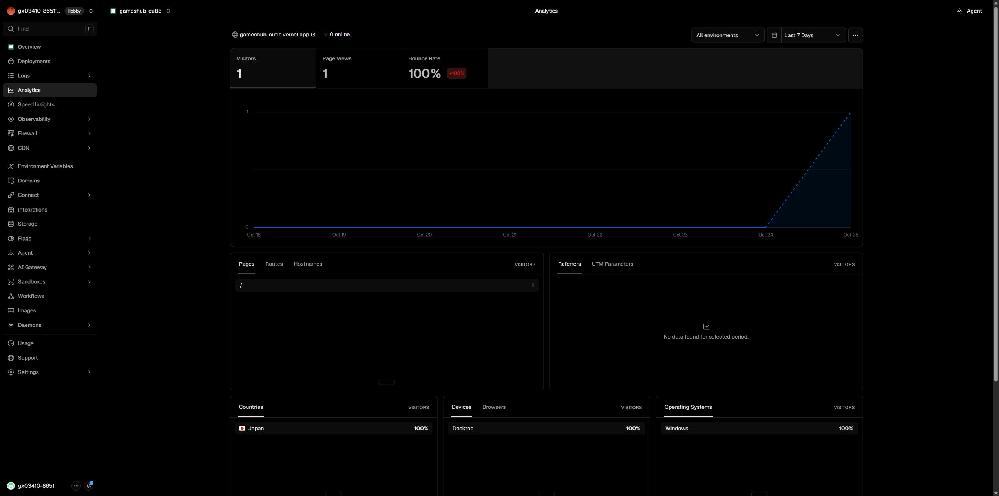

# 17站 Vercel Analytics 与主域名统一验收

2026-10-25（Asia/Shanghai）。站主明确授权为全部17个现有游戏补齐并开启Vercel Web Analytics，将已有独立域名统一为不带www主站、www301，并更新工作台。

## 已验证结果

- 17个独立仓库main已推送，17个原Vercel项目的生产目标全部READY，实际源码SHA与远端提交一致。
- 12站采用无npm构建的官方同源HTML脚本接入，5站安装`@vercel/analytics@2.0.1`并在共享React根布局接入。真实Chrome逐站观察到脚本200和`POST /_vercel/insights/view` 200；17个项目均已开启且后台`webAnalytics.hasData=true`。
- 10个已有独立域名均为apex Production，www301到apex；HTTPS、首页与带查询参数路径跳转、canonical/运行时origin/sitemap一致性均通过。其余7站继续使用各自Vercel默认域。
- 138项正式HTTP检查通过；5站类型/25项引擎测试/生产构建通过；Cluster Rush 110项、Acceleration City 94项、Snow Rider 80项既有静态与导出回归通过；管理仓库18项回归通过。
- 实际8站index、9站noindex保持原有状态。Cluster Rush补齐apex canonical但保留noindex；Snow Rider保留正式域名游玩验收暂缓，只增加apex canonical，不开启索引或生成原先暂缓的sitemap。
- 隐私说明与真实接入同步；统计URL过滤查询参数和片段，不发送游戏答案、按键或本地成绩。测试访问会出现在统计中，不应当作自然搜索流量。

## 当前生产地址与源码

| 游戏 | 当前生产地址 | 生产源码 | 域名设置 |
|---|---|---|---|
| Block Blast Unblocked | [https://playblockblastunblocked.com](https://playblockblastunblocked.com/) | `12fc14528da0` | apex / www301 |
| Costcodle | [https://costcodle.cc](https://costcodle.cc/) | `0fe0d68c1989` | apex / www301 |
| Gulper.Io Game | [https://gulperio.com](https://gulperio.com/) | `b2261def4207` | apex / www301 |
| Krillion Unlimited | [https://krilliononline.com](https://krilliononline.com/) | `91fc881885a2` | apex / www301 |
| Spacebar Counter | [https://spacebarcounter.xyz](https://spacebarcounter.xyz/) | `883bd507b547` | apex / www301 |
| 2048 Cupcakes | [https://2048cupcakes.xyz](https://2048cupcakes.xyz/) | `d872928507b6` | apex / www301 |
| Coreball | [https://gamehubs-coreball.vercel.app](https://gamehubs-coreball.vercel.app/) | `f0db273c7ccd` | Vercel默认域 |
| Minute Cryptic Unlimited | [https://gamehubs-minute-cryptic-unlimited.vercel.app](https://gamehubs-minute-cryptic-unlimited.vercel.app/) | `591ba8347bfe` | Vercel默认域 |
| Snow Rider 3D Unblocked | [https://snowrider3d.top](https://snowrider3d.top/) | `642f2728442e` | apex / www301 |
| Head Soccer 2026 | [https://playheadsoccer.com](https://playheadsoccer.com/) | `238582e12406` | apex / www301 |
| Acceleration City | [https://playaccelerationcity.com](https://playaccelerationcity.com/) | `dd77286748c3` | apex / www301 |
| Cluster Rush | [https://playclusterrush.online](https://playclusterrush.online/) | `d13c6efb129d` | apex / www301 |
| Colordle | [https://gameshub-colordle.vercel.app](https://gameshub-colordle.vercel.app/) | `00d3cb92c9ec` | Vercel默认域 |
| Cutle | [https://gameshub-cutle.vercel.app](https://gameshub-cutle.vercel.app/) | `45ad74cb27e9` | Vercel默认域 |
| Metazooa | [https://gameshub-metazooa.vercel.app](https://gameshub-metazooa.vercel.app/) | `32c7737666ff` | Vercel默认域 |
| Poople | [https://gameshub-poople.vercel.app](https://gameshub-poople.vercel.app/) | `6d60d527c19c` | Vercel默认域 |
| Travle | [https://gameshub-travle.vercel.app](https://gameshub-travle.vercel.app/) | `257b1108b8e6` | Vercel默认域 |

## 证据

[实际生产目标与源码](evidence/2026-10-25-portfolio-analytics/projects-final.json) · [Git推送及显式路径](evidence/2026-10-25-portfolio-analytics/source-releases.json) · [138项HTTP](evidence/2026-10-25-portfolio-analytics/http-verified.json) · [17站真实浏览器请求](evidence/2026-10-25-portfolio-analytics/browser-final.json) · [域名配置回读](evidence/2026-10-25-portfolio-analytics/domains-final.json) · [本地构建检查](evidence/2026-10-25-portfolio-analytics/local-validation.json)。

真实浏览器验收发现React SDK传入route会关闭自动跟踪，必须同时传入path才会发送pageview；5仓已修复、重新部署并实测200。Travle的首次检查发生在新版仍排队时，部署READY后单独复测通过；最终合并结果以browser-final.json为准。既有游玩、真机、性能、许可和搜索引擎收录未因本轮接入而记为通过。

## 沉淀的脚本

- `scripts/vercel-portfolio-settings.mjs`：使用已有Vercel CLI登录态，按显式manifest执行analytics开启、domains统一或inspect回读。已用本轮17项目实际运行三种模式，报告见analytics-enabled.json、domains-final.json、projects-final.json。
- `scripts/check-portfolio-analytics.mjs --manifest deployments/evidence/2026-10-25-portfolio-analytics/manifest.json --report deployments/evidence/2026-10-25-portfolio-analytics/http-verified.json`：只读检查源站、所有页面、bootstrap、统计脚本、robots/sitemap与www301。已实际通过。
- `scripts/check-browser-analytics.mjs --manifest <manifest.json> --opencli <本机OpenCLI入口> --session gamehubs-analytics-<唯一名称> --report <json> [--slugs a,b]`：用户真实Chrome生产导航、统计脚本与真实view响应验证，finally归还会话；本轮static、react与travle三份记录已合并为17站最终证据。无需安装或改动浏览器扩展。

本轮manifest中的root为此设备检出目录，不是跨设备源码身份；另一设备应先按data/sites中的repository/directory/branch定位并重建本机manifest。没有凭据进入报告。
