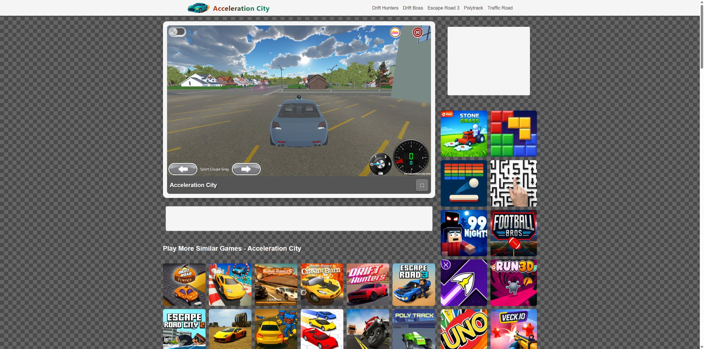
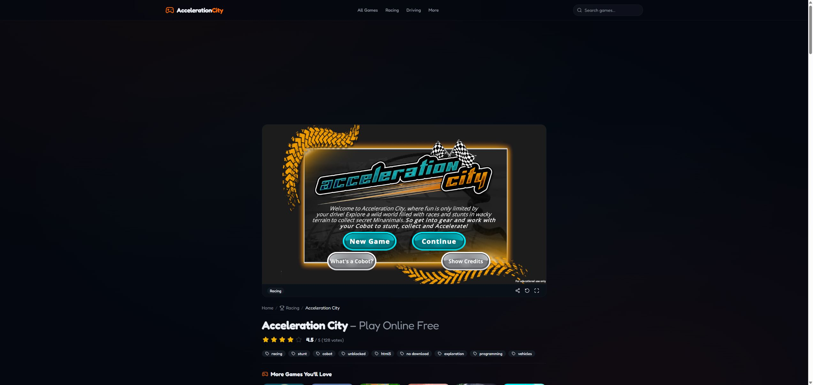
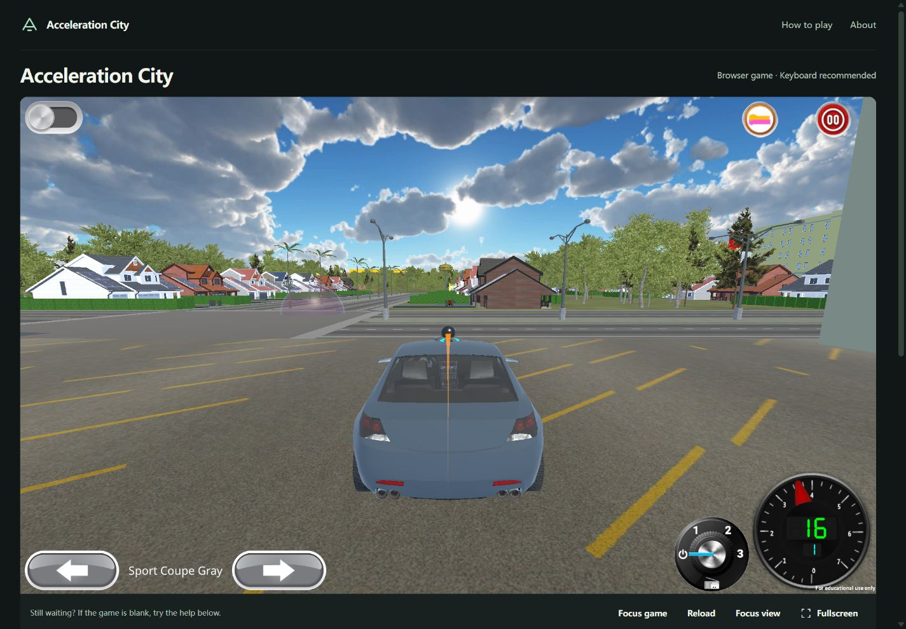

# Acceleration City：竞品取证、难度评估与本地实现

2026-10-24，Asia/Shanghai。范围：英文单游戏站，主词 **acceleration city**。本轮已完成竞品截图、嵌入链路取证、关键词背景、可注册域名查询，以及同方案的本地原型。没有购买域名、部署、接入广告或宣称获得游戏商业授权。

**结论：采用“自建轻量站点 + 直接 iframe 加载 CS2N 原版”的路线。** 原版内核是 Unity WebGL，外层有 React 与 Scratch/Blockly 编程界面。无需把整个 3D 赛车重写一遍。已有门户用 iframe、原版自研这两件事同时成立，不能把 iframe 当作一种游戏引擎。

本地源码：[games/acceleration-city](../../games/acceleration-city/README.md)。预览：[http://127.0.0.1:4198/](http://127.0.0.1:4198/)，需保持预览进程运行。

## 搜索需求与竞争位置

- [Google 实页证据](raw/google-serp.txt)：查询 `acceleration city`，指定 `gl=us&hl=en`；观察到官方 `games.cs2n.org/games/acceleration-city`、freewebgames.io、accelerationcity.cc、coolgamesonline.io、accelerationcity.net、slithergame.io、accelerationcity.io、ozgames.io。**这是一次登录态样本，不是美国无个性化排名报告**；页面页脚仍标示基于历史活动的 Egypt，不能把位置参数当作真实美国定位。
- 主意图是寻找既有游戏并立即游玩。官方 [CMU Hour of Code](https://www.cmu.edu/roboticsacademy/programs/outreach/hour_of_code.html) 与 [CoBox 游戏目录](https://www.cmu.edu/cobox/games/) 确认原作及其可编程 CoBot 的教育背景。
- [美国 / 过去12个月 Trends 同图](https://trends.google.com/trends/explore?date=today%2012-m&geo=US&q=acceleration%20city,gpts)：可见均值 **44 / 17**。主词在 2025-12-14 达 100；2026 年 7 月低至 4–9；最后三周可见值 21、17、23，最新周可能未完整。结论是有明确需求与明显周期变化，近期高于夏季低谷、低于冬春高点；学校日历相关性只是推断。
- [趋势原始表](raw/trends-tables.json) · [截图](screenshots/10-trends-us.jpg)。指数不是月搜索量；本轮没有取得同期 Google Ads/第三方绝对量交叉校准，**月量、KD、收入均未知**。
- 三引擎 autocomplete 成功取得 Google 10、Bing 18、DDG 8 项，包含 game/free play/hour of code/mobile/unblocked 等游玩与教学意图。[关键词分报告](keyword-research.md) · [原始返回](raw/keyword-suggest.json)。该分报告产生于浏览器 Trends 采集前，其“GT未采集”已由本主报告及原始表补齐；绝对月量依然未知。
- GEO 的独立 ChatGPT 自然推荐采样未执行，保留未知。当前立项依据为 SEO 的实际游玩需求及可改善的页面体验，不虚构双路通过。

## 对手究竟如何提供游戏

| 站点 | 已观察的实际链路 | 站点层技术 / 判断 | 截图 |
|---|---|---|---|
| accelerationcity.io | 首页 `iframe#gameIframe[data-src]` → `activities.cs2n.org/acceleration-city/` | HTML/CSS/JS + 按需 iframe；直接用原版，无需登录参数；未发现自研内核证据 | [首页](screenshots/01-io-before-play.jpg)、[菜单](screenshots/02-io-game-loaded.jpg)、[驾驶](screenshots/05-io-gameplay.jpg)、[编程](screenshots/11-io-programming.jpg) |
| accelerationcity.net | 首页 iframe → `escaperoadcity.org/acceleration-city.embed` → CS2N | 静态壳 + 第三方中转。中转源码包含不应复用的账户样式 token，证据已脱敏；本次画面持续为黑屏，只代表这次观察，不证明长期故障 | [实际页面](screenshots/03-net-before-play.jpg) |
| accelerationcity.cc | 首页 iframe → 同站 `/game-embed/acceleration-city` → CS2N | `_next/static` 资源表明 Next.js 站点壳；游戏依旧来自原版。中转带 token，不等于自研游戏或可复用授权 | [初始](screenshots/09-cc-page.jpg)、[原版菜单](screenshots/13-cc-game-loaded.jpg) |
| tops.games | `data-src=/embed/acceleration-city` → `acceleration-city.tops-games.workers.dev` | 门户通过 Worker 域提供 Unity 运行包；Worker HTML 含 `createUnityInstance`、CMRA 公司名和原版 productName。其包被调整为直出 Unity canvas，未见官方 Blockly 外壳；不能据此认定功能完整相同 | [首页](screenshots/07-tops-before-play.jpg)、[启动观察](screenshots/08-tops-after-play.jpg) |
| venkogames.com | `/embed/acceleration-city` → 同一个 tops-games Worker | 门户与游戏包分离。只做了源码链路取证，未截图实玩 | [HTML](raw/venko.html)、[嵌入壳](raw/venkoEmbed.txt) |
| freewebgames.io | 首页 iframe → `/acceleration-city.embed` | 已确认 iframe 第一跳；未追完后续链路，不猜测最终包来源 | [HTML](raw/freeweb.html) |

[HTTP状态、完整 iframe 标签和脚本列表](raw/http-manifest.json) · [强竞品与 Worker 原始证据](raw/additional-manifest.json)。门户中转页 `frame-ancestors 'self'` 表明不能把它们的中转壳当成我们的外链游戏地址。

官方 `main.js` 中的 Unity 配置明确出现 `unity_game.loader.js`、`.data.unityweb`、`.framework.js.unityweb` 和 `.wasm.unityweb`，公司字段是 Carnegie Mellon Robotics Academy。[原始脚本](raw/officialMain.txt)。资源 HEAD 均返回200，但没有可靠 Content-Length，**没有把未知包体大小写成0或估计下载时间**。[头信息](raw/game-asset-headers.json)

## 截图中的真实体验与可改善处

原版实机有城镇道路、车辆选择和可编程机器人；竞品的“纯霓虹城市”“固定 E 建坡道”“Space 一定跳跃”等文案不能直接当事实。W 前进已实测，点击原版左上开关可进入 Blocks；当时编辑器出现 `when E is pressed`、spawn、move ahead、return to、speed、wait、repeat。这说明触发键与动作由程序组合，不是每个键永远绑定一个相同技能。

`.io` 的棋盘背景、空广告位和大量无关游戏缩略图抢占首屏；`.net` 的本次黑屏没有就近恢复提示；`.cc` 内容与专题覆盖更强，是需要认真对标的对手，但其桌面画面顶部有大块留白。我们保留它们的即时游玩目的，提供更集中的画面、准确来源、原创上手帮助与恢复路径。

## 复刻与开发难度

以下是工程判断，按一名熟悉 Web 开发的工程师估算，不是交付承诺；授权等待不计入开发工期。

| 路线 | 难度 | 估算工作量 | 能做到与不能做到 |
|---|---|---|---|
| 同方案直接 iframe + 优质站点壳 | 低–中，2/5 | 基础可玩壳约0.5–1天；教程、SEO、恢复状态与跨设备核验约2–4天 | 能改善首屏、说明、加载反馈、全屏容器和页面稳定性；不能独立修改原版物理、内容、包体或跨源存档 |
| 自托管原版 Unity 包并改壳 | 中–高，4/5 | 获得适当源码/许可后约1–3周，视代码与构建环境而定 | 要处理 Unity版本、压缩头、WASM、StreamingAssets、存档与Blockly消息桥；仅复制公开包不等于有源码或授权 |
| 独立重做完整同等玩法 | 高，5/5 | 熟练小团队约8–16周以上，画面、地图与内容量可能继续扩大 | 车辆物理/摄像机、3D城市、车型、竞速/收集、CoBot可视化编程、运行时消息桥、保存和性能均需实现 |

**本轮采用第一条。** 同原版内核下，我们能让“进入与游玩环境”更好；不会声称已改良游戏本体，也不会承诺 SEO 排名必然超过官方和竞品。

## 已实现的 SEO 与体验改进

- 独立静态 HTML/CSS/JS，按点击再连接 CS2N；不经竞品中转、不含其 token、不注入广告 SDK。
- 主词归首页；真实原创 guide 覆盖上手/CoBot/加载问题；About说明独立站身份和第三方数据边界。没有批量伪造 2/3/unblocked 镜像页，也没有虚构下载、评分或玩家数量。
- Title/description、英文语种、唯一H1、VideoGame/WebPage/Breadcrumb JSON-LD、OG实机截图、单点 SITE_ORIGIN 生成 canonical/robots/sitemap。结构化数据不代表一定获得富结果。
- 默认 noindex。本地及预览不与未来正式域名争夺索引；生产导出同时要求实际域名和游戏嵌入许可确认。正式发布、GSC、索引与CWV均未执行。
- 游戏容器、焦点按钮、专注视图、全屏失败回退、重载确认及靠近游戏的恢复帮助。页面不伪造跨源游戏准备进度、静音、得分或暂停能力。
- 桌面1440×1000，修改前实测游戏视口约占首屏74.65%，无横向溢出。后续微调给工具栏留出更多高度，需新一轮截图确认。

## 域名：实时可注册候选

查询时间 **2026-10-24 10:32（北京时间）**，Vercel Registrar公开接口；[完整请求和返回](raw/domain-availability.json)。均为1年美元报价、非溢价；未计可能税费/汇率。没有购买或预留，成交前需重查；未完成历史内容/商标风险尽调。

| 优先级 | 域名 | 本次结果 | 注册 / 续费（USD/年） | 选择理由 |
|---|---|---|---|---|
| 首选 | **playaccelerationcity.com** | 可注册 | **11.25 / 11.25** | 直接表达来此游玩，保留完整游戏词组，.com易记 |
| 次选 | **accelerationcitygame.com** | 可注册 | **11.25 / 11.25** | 完整名称 + game，游戏意图明确 |
| 次选 | **accelerationcityonline.com** | 可注册 | **11.25 / 11.25** | 对应在线游玩意图，稍长 |
| 备选 | accelerationcityplay.com | 可注册 | 11.25 / 11.25 | 词组完整，语序不如play前置自然 |
| 备选 | acceleration-city.com | 可注册 | 11.25 / 11.25 | 接近名称，但口头传播易漏连字符 |
| 备选 | accelerationcity.games | 可注册 | 14.99 / 31.82 | 游戏语义直接，续费较高 |
| 低优先 | accelerationcity.gg | 可注册 | 129.99 / 129.99 | 简洁但成本明显高，未证明额外搜索收益 |
| 不选 | accelerationcity.com | 未确认可注册（available:false） | 未提供 | 不能按普通新注册候选推荐；返回false本身不证明所有权情况 |

域名的优势是识别性、记忆和游玩意图，不是额外排名权重。Google 的 [exact-match domain system](https://developers.google.com/search/docs/appearance/ranking-systems-guide#exact-match-domain) 专门防止对精确匹配域名给予过高权重。游戏名称仍属于原作，独立站须清楚标明身份。

## 验证结果与上线边界

- 源码与导出配置检查通过，最新数量及列表以 [verification.json](../../games/acceleration-city/scripts/verification.json) 为准。测试使用保留的 `.invalid` 域验证生产配置，从未部署。
- [本地HTTP核验](raw/local-http-checks.json)：9个真实页面/资源返回200，缺失路径返回404，预览响应全部带noindex。
- 真实Chrome：竞品游戏菜单/驾驶/Blocks、本地原版加载/Continue/驾驶、专注视图进入和退出均观察成功。[截图目录](screenshots/)
- Fullscreen API被当前浏览器自动化环境拒绝，回退专注视图成功；**原生全屏未获实测通过**。
- 旧版重载 `window.confirm` 令控制通道超时，随后 CUA 因无法可靠识别 Windows 页面URL停止本轮。已改成页内确认，但新确认流程、移动端截图、最后的小幅高度修订**尚未重新浏览器验收**。不以静态检查替代这些结果。
- 独立设计复核的结论为 **recapture**，停在证据完整性检查，未给出视觉通过结论。[复核记录与最小补拍矩阵](finish-review.md)。机械扫描的一条 skip-link hover 对比度问题已在源码修正；逻辑间距提示仍需真实渲染复核，没有把扫描输出当作全量无障碍验收。
- 原版画面右下写有 **“For educational use only”**。公开可访问且技术上能嵌入，不等于已确认可做广告商业站。没有发现可据以商用分发的明确许可；因此保持本地 noindex 原型。商业发布必须先取得适当授权/确认，不能靠勾选环境变量代替许可事实。
- 未完成真实手机游玩、3G/CWV/Lighthouse、绝对搜索量、GEO采样、域名历史尽调或正式站排名验证；没有流量、收入或超越竞品的结果承诺。

## 沉淀的脚本

- `fetch-evidence.cjs`：竞品与官方HTML、iframe及脚本清单；已执行。
- `trace-embeds.cjs`：追踪游戏中转及Unity入口，输出保存前移除token；已执行。
- `fetch-additional.cjs`：补充真实SERP出现的强竞品与Worker证据；已执行。
- `verify-public-sources.mjs [output-directory]`：资源HEAD与8个域名的实时注册/续费核验；已按真实参数执行，返回记录在raw目录。
- `games/acceleration-city/scripts/build.mjs`、`serve.mjs`、`verify.mjs`：分别用于默认noindex导出、本地预览、配置核验；均已执行。
- 截图采用本轮 CUA 浏览器接口，OpenCLI本机不可用；已保存实际截图与命名索引，不声称存在可独立重放的截图CLI。后续复测应使用可用浏览器通道，先处理遗留确认框。

维护：结论统一于本报告；源码/设计边界保留在游戏目录，根HANDOFF只留接力指针。其他游戏及已有未提交内容未改动。
