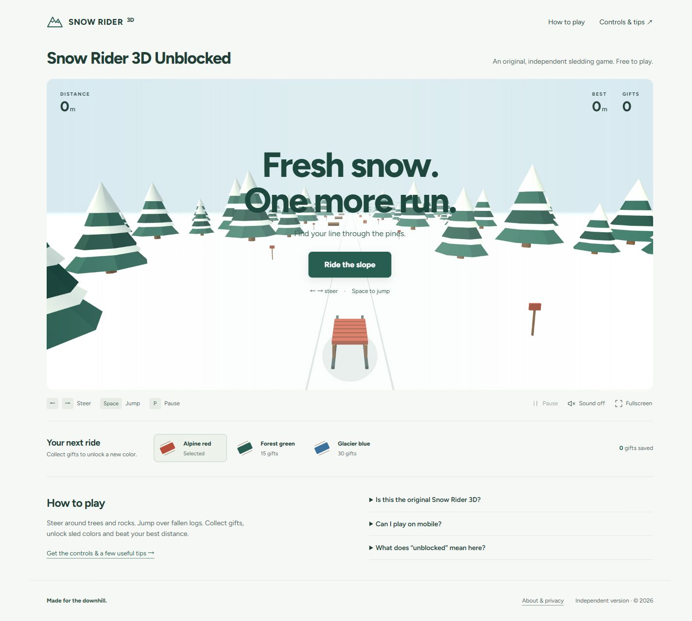
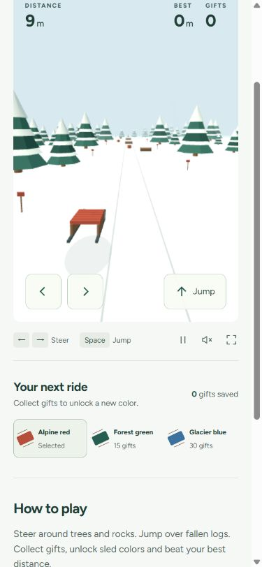

# Snow Rider 3D Unblocked — research, design and original build

> Superseded later on 2026-10-24: the owner requested the existing game instead of the original demo. Current implementation uses GameDistribution's public player; see [package sourcing and replacement](PACKAGE-SOURCING.md). Original-engine tests and screenshots below are historical evidence, not current player validation.

2026-10-24, Asia/Shanghai. Scope: an original independent browser game; no deployment or domain purchase. [Research/design plan](PLAN.md) · [Game source](../../games/snow-rider-3d-unblocked/README.md) · preview http://127.0.0.1:4197/ (server must remain running).

## Decision and search evidence

The owner explicitly selected original development, clearly labeled as independent. The main query strongly implies players seeking the established game, so an original alternative has a search-intent tradeoff. The homepage discloses the difference before play. No copied Unity package, misleading official identity, fake ratings or network-bypass claims.

Primary keyword: **snow rider 3d unblocked**. Secondary: **snow rider 3d online**, **snow rider 3d controls**, **snow rider 3d tips**. Homepage owns the play query; one supporting guide answers controls and actual mechanics; About provides identity/privacy/credits. No repetitive 66/76/911 landing pages.

Live [Google Trends comparison](https://trends.google.com/trends/explore?date=today%2012-m&geo=US&q=snow%20rider%203d%20unblocked,snow%20rider%203d,gpts), US / past 12 months: displayed means 5 / 30 / 6 for the exact query, broad query and gpts. Exact query peaked at 21 in the week of 2025-12-14 and showed 2 in each of the last two visible weeks. Summer was much lower. These are same-chart normalized indices, not monthly search counts. Current demand is below the observed winter peak; do not call this a currently surging keyword. A school-calendar explanation is an inference, not proven causation. [Visible table evidence](trends-visible-tables.json).

Monthly volume, KD and calibrated absolute magnitude: **unknown**. AI recommendation sampling: **not performed**. Autocomplete returned no suggestions in this request; it does not establish no demand. No traffic, ranking or revenue promise. [Google's exact-match domain system](https://developers.google.com/search/docs/appearance/ranking-systems-guide) does not automatically reward a query-matching domain. Domain scoring below is editorial relevance/readability, not an observed ranking prediction.

## Design and implementation

An expansive original low-poly snow forest is the central playable view, with warm-white shell, evergreen controls and red sled/gifts. Real WebGL 2, original geometry and simulation; locally pinned Three.js 0.180.0 MIT renderer and Figtree OFL. Controls: continuous steering, jump, pause/auto-pause, retries, optional synthesized sound, fullscreen, local best/gift bank and unlockable colors. Original obstacle placement varies within lanes while leaving a reachable open line. No install, account, tracking, ad SDK or runtime CDN.

Title, description, single H1, VideoGame JSON-LD, OG screenshot, favicon/app icons and internal guide links are implemented. Preview/source remain noindex. Export with an owned `SITE_ORIGIN` enables index/follow, canonical, absolute social/schema URLs, robots and a three-URL sitemap. An explicit Vercel preview environment always forces noindex. No production origin is selected.

## Domain tests

Registry checks at **2026-10-24 10:10 CST**. [Raw RDAP evidence](domain-evidence.json). A registry 404 indicates no current registry record; it is not a registrar reservation or guaranteed purchase offer.

| Candidate | Registry result | Assessment |
|---|---|---|
| **snowrider3donline.com** | 404, record not found | **First choice:** complete game phrase + online play intent, readable .com; can target unblocked on homepage without an access promise in the domain. |
| **snowrider3dplay.com** | 404, record not found | Backup: shorter, retains full game phrase and direct play intent. |
| snowrider3dunblocked.com | Registered | Exact match, unavailable for ordinary new registration. |
| snowrider3dunblocked.net | Registered | Exact match, unavailable. |
| snowrider3dunblocked.org | Registered, redemption period | Not available for ordinary registration; do not treat redemption as availability. |
| playsnowrider3d.com | Registered | Short play-intent choice already registered. |
| snowrider3dfree.com | Registered | Already registered. |
| snowrider3dunblocked.xyz | Registered; hold/redemption/pending-delete statuses | Do not treat as available or safe to purchase now. |

Spaceship finalist query encountered Cloudflare security verification; no verification challenge was solved, purchase initiated or price confirmed. Wayback CDX request returned HTTP 429. Historical cleanliness, registrar availability, registration/renewal price and premium status remain **unknown**. The recommendation is a shortlist based on current registry evidence, not a final purchase clearance. Source: [Verisign first choice RDAP](https://rdap.verisign.com/com/v1/domain/snowrider3donline.com), [backup RDAP](https://rdap.verisign.com/com/v1/domain/snowrider3dplay.com).

## Validation and limits

- **10/10 engine tests passed:** reproducible/fair courses, no permanent safe gaps across 30 seeded long courses, pause/resume, bounds/stall cap, collisions, log clearance, tall-tree danger, single gift collection, jump lifecycle and invalid saves.
- **59 static/export checks passed:** metadata, H1, local links/assets, JSON-LD, source noindex, production canonical/social URLs/sitemap/robots, preview override and invalid-origin rejection. [Machine report](../../games/snow-rider-3d-unblocked/scripts/verification.json).
- **12 local HTTP checks returned 200** for the three pages, renderer/game modules, representative images and robots. [HTTP evidence](http-checks.json).
- Real user Chrome verified initial WebGL render, keyboard steering, pause, insufficient-gift feedback and mobile pointer steering. [Browser evidence and precise limitations](browser-checks.json).
- A fresh finish reviewer found a fixed safe corridor and fullscreen touch-control omissions; code is corrected. Final contrast, sound-state icon and fullscreen interactions **still need browser recapture**, because CUA stopped Computer Use after connection failures and inability to determine the current browser URL safely. Captures shown below predate that final small batch. No complete final visual approval is claimed.
- No public-origin Lighthouse, simulated-3G measurement, real-device performance, GSC, indexing or production deployment is claimed. This is a locally built site with remaining browser verification, not an all-green launch certification.

## 沉淀的脚本

- `research-domains.mjs`: public registry and autocomplete evidence; executed with actual eight candidates.
- `games/snow-rider-3d-unblocked/scripts/engine.test.mjs`: executed; 10 tests pass.
- `games/snow-rider-3d-unblocked/scripts/verify.mjs`: executed; 59 checks pass and final export restored to noindex.
- `games/snow-rider-3d-unblocked/scripts/build.mjs`: executed in preview, synthetic production-origin and Vercel preview modes; safe output only.
- `games/snow-rider-3d-unblocked/scripts/serve.mjs`: executed on 4197, HTTP responses verified.

Next: restore browser access and complete the three visual/interaction checks; manually confirm registrar availability/renewal price/history for the preferred domain; purchase only with owner authorization; configure actual origin and deploy before any indexing setup.
